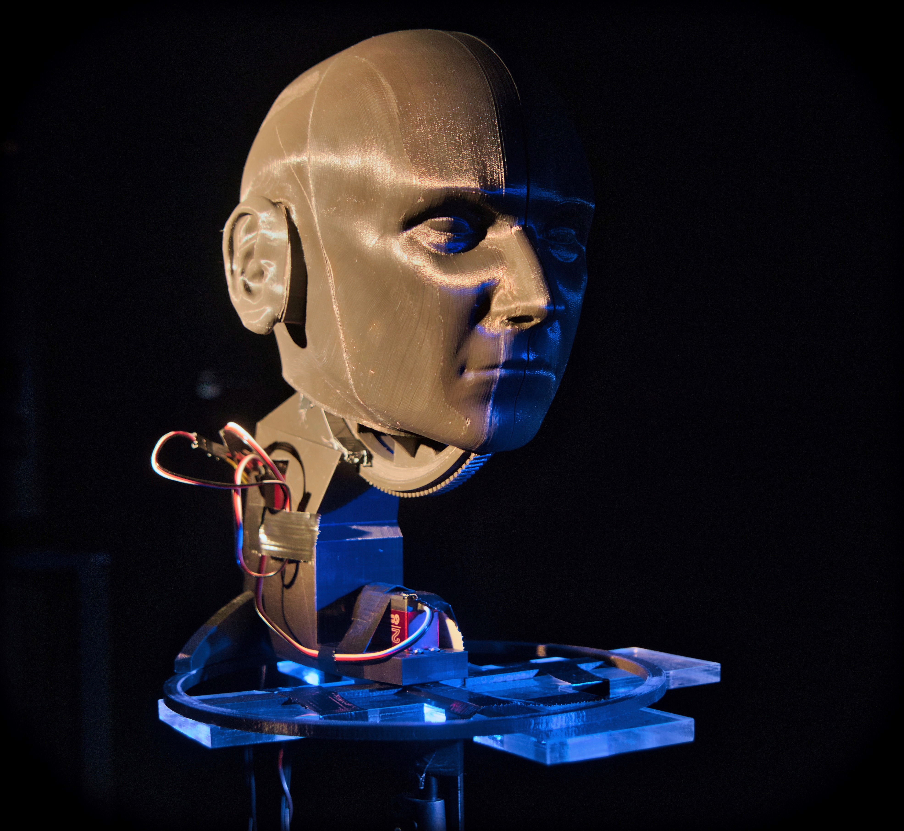
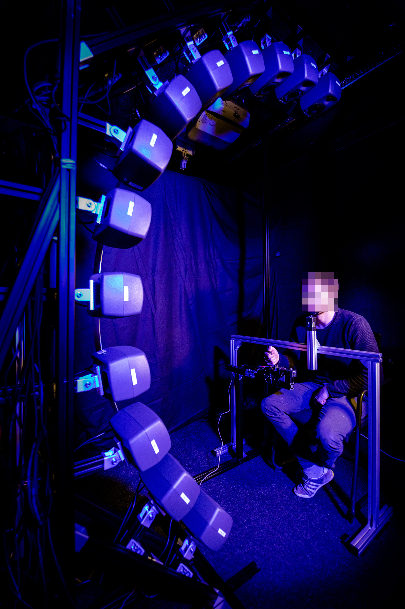

# About

Currently, I am a postdoctoral researcher with Marc Ernst at the [Applied Cognitive Psychology Department](https://www.uni-ulm.de/en/in/psy-acog/) at Ulm University where I continue to work on computational models for control, learning and auditory motion perception.
As principal investigator of the Ulm Postdoc Research Grant project _From Sound to Attention via Adaptive Perceptual Filtering_, I am setting up EEG experiments on auditory attention. To study auditory motion perception during active head and eye movements, we use a cable-driven robot that moves real sound sources around the listener while head and eye movements are tracked (see [video](#motion-setup-video)).

In summer 2026, I was a visiting researcher in [Rob Allison's lab](https://www.yorku.ca/research/project/virtual-reality-and-perception-lab/) at the Centre for Vision Research, York University (Toronto), where I investigated the role of eye movements in auditory motion perception using virtual reality and eye tracking (funded by the Ontario–Baden-Württemberg Faculty Mobility Program).

Before that, I was a postdoctoral researcher with Carsten Mehring at the [Neurobiology and Neurotechnology Group](https://www.brain.uni-freiburg.de/) at the [Bernstein Center Freiburg](https://www.bcf.uni-freiburg.de/) working on computational models for motor control. Specifically, I was using recurrent neural networks and reinforcement learning to construct biologically plausible models of the motor cortex.

Before that, I was a PhD student with Marc Ernst and Heiko Neumann at the [Applied Cognitive Psychology Department](https://www.uni-ulm.de/en/in/psy-acog/) at Ulm University, from where received a PhD in computer science in 2021. 
The topic of my PhD thesis was [From sound waves to locations : computational models for sound source localization in the early auditory pathway](https://oparu.uni-ulm.de/xmlui/handle/123456789/39600). 

The thesis focuses on computational models for auditory sound source localization, multisensory integration and the deployment of such models on neuromorphic hardware and robotic platforms ([see project website](https://www.uni-ulm.de/in/neuroinformatik/forschung/schwerpunkte/va-morph/)). To conduct experiments with these models, I designed a 3D-printed movable human head (see [video](#auditory-cue-following-video)) and a experimental setup for testing human behavior.

  
   

In 2016, I graduated from Technical University München (TUM) with a Master's degree in Robotics, Cognition and Intelligence. For my master's thesis, I went to the [Cognitive Anteater Robotics Laboratory (CARL)](http://www.socsci.uci.edu/~jkrichma/CARL/index.html) at the University of California as a junior specialist, working with Jeffrey Krichmar on a computational model for spatial navigation see [Frontiers in Neurorobotics 2017](https://www.frontiersin.org/articles/10.3389/fnbot.2017.00004/full).
After my master's, I co-founded the start-up Foxim (Cologne), a conversational-commerce platform, where I was lead developer (2016–2017).

<!-- 
 <a href="/assets/cv_oess.pdf">My CV</a> 
 -->

 
# Publications

## Submitted & Preprints
* _Natural spatial hearing relies on binaural spectral disparity to cancel source-spectrum ambiguities_, Oess, Roy, Neumann, Ernst [Earlier version on bioRxiv](https://doi.org/10.1101/2020.09.10.291468)
* _Moving heads, moving sounds: systematic errors in auditory motion perception_, Oess, Harris, Ernst, bioRxiv 2026, [Preprint Full Text](https://doi.org/10.64898/2026.11.05.764571)
* _The where and when of tracking sound sources: head-based auditory motion tracking integrates velocity and spatial error within a common delayed frame_, Oess, Iriventi, Ernst, bioRxiv 2026, [Preprint Full Text](https://doi.org/10.64898/2026.11.09.765311)
* _Adding 3D space to human navigation: Humans stop short of home after walking over a bridge_, Roy, Wünning, Oess, Ernst, PsyArXiv 2026, [Preprint Full Text](https://doi.org/10.31234/osf.io/sgw7u_v2)

## 2026
* _Dynamic sensor adaptation based on efferent feedback for adaptive bio-inspired sound source localization_, Durstewitz, Schmid, Oess, Ghazanfari, Neumann, Ernst and Lenk , Frontiers in Neuroscience, [Full text](https://doi.org/10.3389/fnins.2026.1736957)

## 2023
* _Listen to the Brain–Auditory Sound Source Localization in Neuromorphic Computing Architectures_, Schmid; Oess ; Neumann, Sensors, [Full text](https://www.mdpi.com/1424-8220/23/9/4451)

## 2021
* _From sound waves to locations: computational models for sound source localization in the early auditory pathway_, Oess, Doctoral dissertation, Ulm University, [Full text](https://doi.org/10.18725/OPARU-39524)
* _Brain-inspired Visual-Auditory Integration Yielding Near Optimal Performance – Modelling and Neuromorphic Algorithms_, Oess, Neumann, ERCIM News 125, [Full text](https://ercim-news.ercim.eu/en125/special/brain-inspired-visual-auditory-integration-yielding-near-optimal-performance-modelling-and-neuromorphic-algorithms)

## 2020
* _Computational principles of neural adaptation for binaural signal integration_, PLOS Computational Biology, [Full text](https://doi.org/10.1371/journal.pcbi.1008020)
* _From near-optimal Bayesian Integration to Neuromorphic Hardware: A neural network model of multisensory integration_, Frontiers in Neurorobotics, [Full text](https://doi.org/10.3389/fnbot.2020.00029)
* _A Bio-Inspired Model of Sound Source Localization on Neuromorphic Hardware_, International Conference on Artificial Intelligence Circuits and Systems (AICAS), [Full text](https://www.informatik.uni-ulm.de/ni/mitarbeiter/HNeumann/publicationsYear/PDFs/CONFERENCES/IEEE-AICAS20-OessEtAl-soundSourceLocalizationNeuromorphicTrueNorth.pdf)
* _Computational investigation of visually guided learning of spatially aligned auditory maps in the colliculus_,  Proceedings of the International Symposium on Auditory and Audiological Research, [Full text](https://proceedings.isaar.eu/index.php/isaarproc/article/view/2019-18)

## 2017
* _A Computational Model for Spatial Navigation Based on Reference Frames in the Hippocampus, Retrosplenial Cortex, and Posterior Parietal Cortex_, Frontiers in Neurorobotics, [Full text](https://www.frontiersin.org/articles/10.3389/fnbot.2017.00004/full)

## 2013
* _Multiobjective Reinforcement Learning Using Actor-Critic Framework and Reservoir Computing_, Oubbati, Oess, Fischer, Palm, Workshop on Reinforcement Learning with Generalized Feedback (ECML PKDD), [Full text](https://www.ecmlpkdd2013.org/wp-content/uploads/2013/09/PBRL_07-Oubbati.pdf)

 

# News

* 2026 New preprints on bioRxiv: [Moving heads, moving sounds](https://doi.org/10.64898/2026.11.05.764571) and [The where and when of tracking sound sources](https://doi.org/10.64898/2026.11.09.765311)
* 2026 Two-month research stay as visiting researcher in Rob Allison's lab, York University, Toronto (Ontario–Baden-Württemberg Faculty Mobility Program)
* 2026 Awarded the Ulm Postdoc Research Grant for the project _From Sound to Attention via Adaptive Perceptual Filtering_
* 2023 Co-organiser of the international conference FRoBio – Freiburg Robotics and Biology (funded by FRIAS)
* 2021 ERCIM News article ["Brain-inspired Visual-Auditory Integration Yielding Near Optimal Performance – Modelling and Neuromorphic Algorithms"](https://ercim-news.ercim.eu/en125/special/brain-inspired-visual-auditory-integration-yielding-near-optimal-performance-modelling-and-neuromorphic-algorithms) (Special theme on "Brain-Inspired Computing")
* 2017 IDW - Informationsdienst Wissenschaft news article [Vom Gehirn zur Robotik: Algorithmen verarbeiten Sensordaten wie das Gehirn](https://idw-online.de/en/news681636)

# Presentations
* _The Shepard Swing: tracking endogenous bistability beyond vision_, Domenici, Oess, Wünning, Ernst, Talk (co-author) at the International Multisensory Research Forum (IMRF), Genoa, Italy, 2026

* _Auditory parsing. The effect of head movement on the perceived direction of a moving sound source_, [Talk](/assets/talk_IMRF_final.pdf) at the [IMRF Conference](https://imrf2025.sciencesconf.org/?lang=en), Durham, UK, 2025

* _Biological-plausible learning with a two compartment neuron model in recurrent neural networks_, [Poster](/assets/poster_bc_2024.pdf) at the [Bernstein Conference](https://bernstein-network.de/bernstein-conference/), Frankfurt, Germany 2024

* _Two ears are better than one_, Poster at the FENS Summer School "Artificial and natural computations for sensory perception", Bertinoro, Italy 2022

* _A Bio-Inspired Model of Sound Source Localization on Neuromorphic Hardware_, [Poster](/assets/poster_aicas_2020.pdf) at the [International Conference on Artificial Intelligence Circuits and Systems](https://www.aicas2020.eu/), Online 2020

* _Computational investigation of visually guided learning of spatially aligned auditory maps in the colliculus_, [Talk](/assets/presentation_isaar.pdf) at the [International Symposium on Auditory and Audiological Research](http://www.isaar.eu/), Nyborg, Denmark 2019

* _Monoaural and Binaural Sound Source Localization in the Median Plane_, [Poster](/assets/poster_kosice.pdf) presentation at the 4th workshop on [cognitive neuroscience of auditory and cross-modal perception](https://pcl.upjs.sk/workshop2019/), Košice, Slovakia 2019

 
# Videos

## Moving Sound Sources Setup {#motion-setup-video}

A cable-driven robot moves a real sound source around the listener, while head movements are tracked, to study auditory motion perception during active head movements.

<video src="/assets/motion_setup.mp4" poster="/assets/images/motion_setup_poster.jpg" width="640" style="max-width:100%;height:auto" controls preload="metadata" playsinline></video>

## Auditory Cue Following {#auditory-cue-following-video}

<video src="https://www.uni-ulm.de/fileadmin/website_uni_ulm/iui.inst.160/Psychologie/Applied_Cognitive_Psychology/Filme/VA-Morph.mp4" width="640" height="480" controls preload></video>
